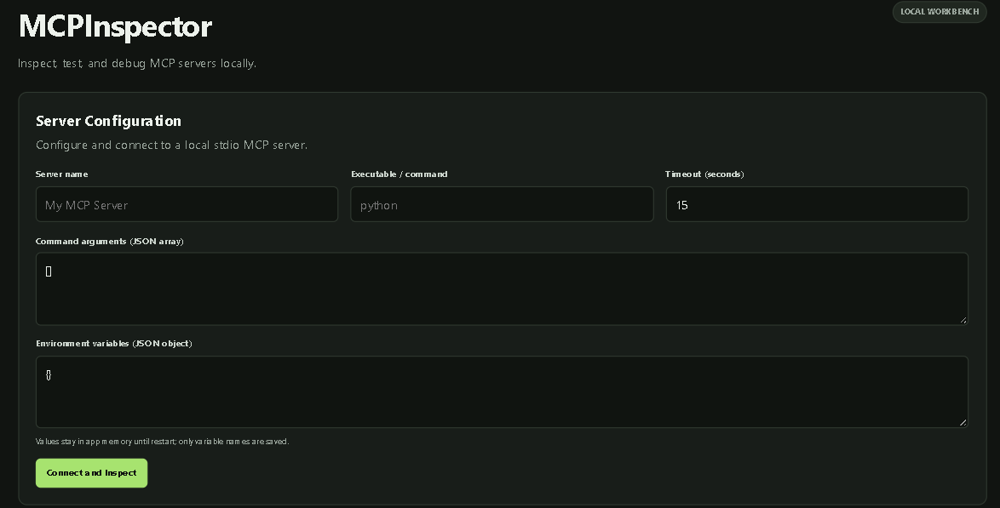
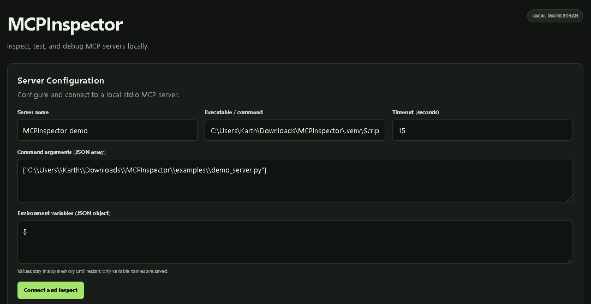
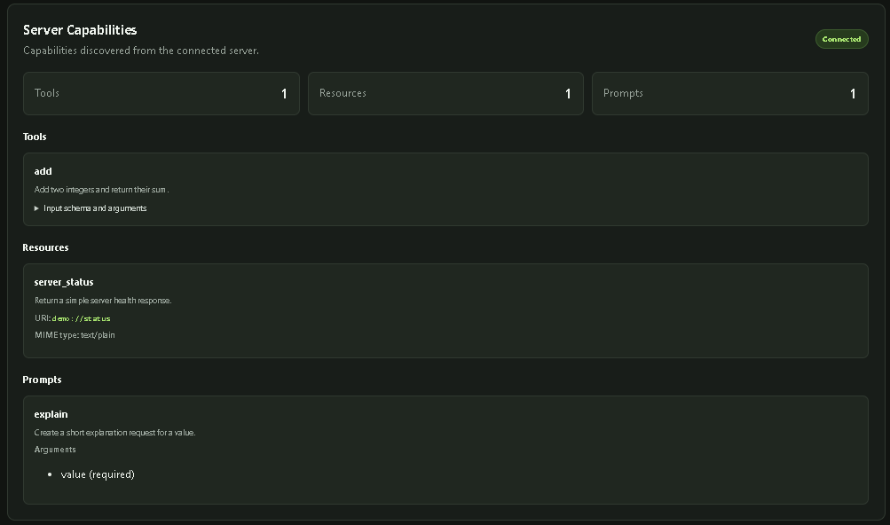
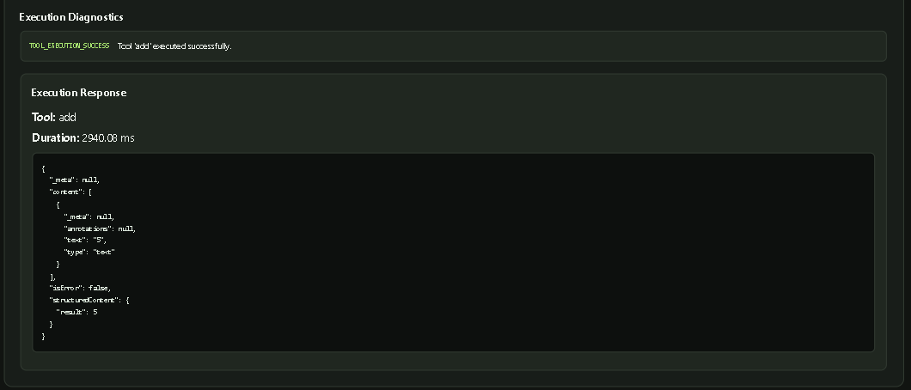
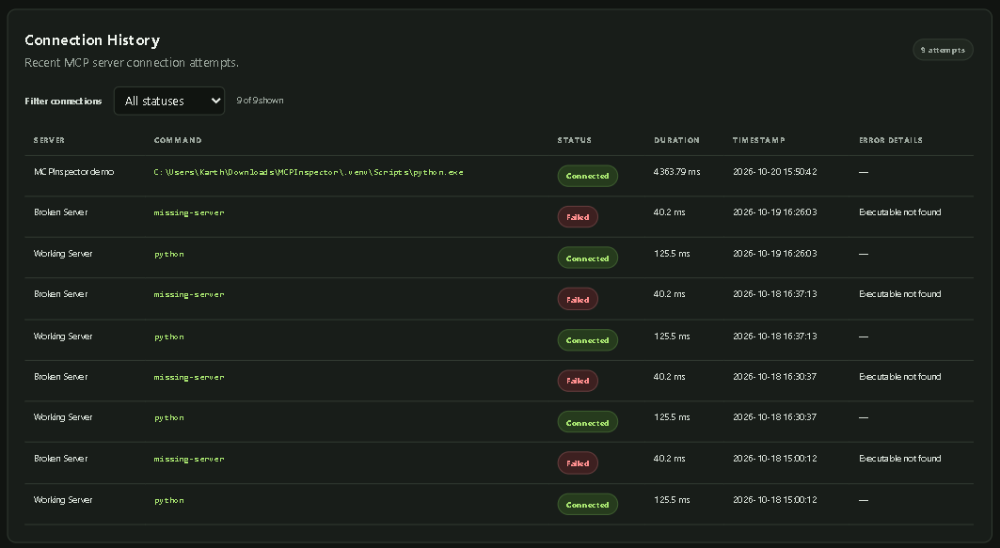
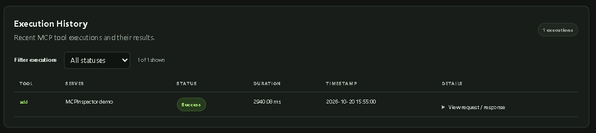

# MCPInspector

MCPInspector is a local Flask workbench for connecting to Model Context Protocol (MCP) servers over stdio, browsing their tools, resources, and prompts, and testing tool calls with JSON arguments. Server configurations and recent connection and tool-execution history are stored in SQLite.

## Features

- Connect to local MCP servers over stdio.
- Discover MCP tools, resources, and prompts.
- Execute tools using JSON arguments.
- Diagnose configuration, connection, and execution errors.
- Save server configurations for reuse.
- Track connection and tool-execution history.
- Persist data using SQLite.
- Inspect execution results, status, and duration.

## Workflow Architecture

The workflow architecture illustrates how the dashboard, Flask application, MCP client service, external MCP server, and SQLite database interact.


## Screenshots

### 1. Application Dashboard

The main dashboard for configuring MCP servers and accessing the application's functionality.



### 2. Server Configuration

Configure the server name, executable, command arguments, environment variables, and connection timeout.



### 3. Discovered MCP Capabilities

View the tools, resources, and prompts discovered from the connected MCP server.



### 4. Tool Execution

Execute an MCP tool with JSON arguments and inspect the returned result and execution status.



### 5. Connection History

Review recorded connection attempts, their statuses, durations, and available error details.



### 6. Execution History

Review recorded tool executions, including arguments, results, statuses, and durations.




## Requirements

- Windows 10 or later
- Python 3.12
- An MCP server that supports stdio (optional for connecting through the UI)

The included demo server uses the official Python MCP SDK installed from `requirements.txt`. Node.js or an external service is not needed to run it.

## Windows Setup

Open PowerShell in the project directory and create a virtual environment:

```powershell
py -3.12 -m venv .venv
.\.venv\Scripts\Activate.ps1
python -m pip install --upgrade pip
python -m pip install -r requirements.txt
```

If PowerShell blocks activation, use the interpreter directly instead:

```powershell
.\.venv\Scripts\python.exe -m pip install -r requirements.txt
```

## Start the Application

With the virtual environment active, run:

```powershell
python app.py
```

Open [http://127.0.0.1:5000](http://127.0.0.1:5000) in your browser.

The application binds to loopback only. Its SQLite database is created automatically at `instance\mcpinspector.db`.

Set `MCPINSPECTOR_DATABASE` before starting the application to use a different database file.

## Run Tests

Run the complete test suite from the project root:

```powershell
python -m pytest -q
```

The suite uses temporary databases and includes a real stdio integration test against the bundled local demo server. It does not require a remote MCP server, an API key, or a paid service.

## Configure an MCP Server

In **Server Configuration**, enter a display name, an executable, its argument array as JSON, environment variables as a JSON object, and a timeout from 1 to 120 seconds.

For example, to use the included demo server:

- **Server name:** `MCPInspector demo`
- **Executable / command:** The Python executable from the active virtual environment, such as `C:\Users\you\MCPInspector\.venv\Scripts\python.exe`
- **Command arguments:** A JSON array containing the path to `examples\demo_server.py`
- **Environment variables:** `{}`
- **Timeout:** `15`

Use the actual project path on your machine. The demo server exposes an `add` tool, a `demo://status` resource, and an `explain` prompt.

After connecting, select the `add` tool and enter the following arguments:

```json
{
  "a": 2,
  "b": 3
}
```

The expected calculation result is `5`.

For another local stdio server, set the executable to its runtime (for example, `python` for a Python server) and provide the server script or module and its arguments in the JSON array. Do not include shell quoting in the executable or construct a shell command; MCPInspector starts the executable and argument list directly.

## Troubleshooting

- **Executable not found:** Verify the executable name or enter its full path. If it depends on `PATH`, start MCPInspector from a shell where that `PATH` is configured.
- **Connection timeout:** Start the server independently to check its installation, then increase the timeout if startup normally takes longer. An MCP stdio server must use stdout for protocol messages, not console logs.
- **Invalid configuration or JSON:** Arguments must be a JSON array of strings; environment variables and tool arguments must each be JSON objects.
- **Tool not discovered:** Reconnect and choose a tool listed in the current server's discovered capabilities.
- **Environment values after restart:** Environment values are held only in application memory and are intentionally not saved. Re-enter them in the configuration form and reconnect after restarting MCPInspector.

## Security and Local Use

MCPInspector is intended for local use. It binds only to `127.0.0.1` and does not provide authentication or public hosting.

Environment values are not written to saved server configurations, history, or application logs, and are not included in the returned dashboard page. They are discarded when the application process exits.

Tool arguments and results are recorded in execution history, with configured environment values redacted if they appear in that data.

Only connect to MCP servers you trust, and review their commands before running them.
---